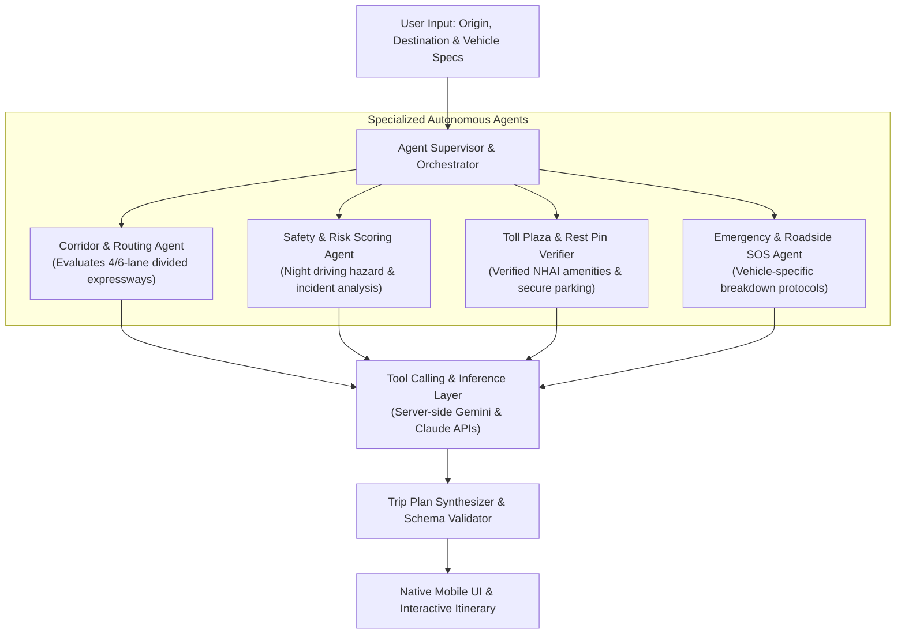

# SafeTrip: Autonomous AI Agent Highway Route & Safety Planner

> **SafeTrip (Project-TripAgent)** is an autonomous multi-agent road trip safety engine designed specifically for Indian highways and expressways. It moves beyond standard map routing by deploying autonomous AI agent evaluators that prioritize divided 4/6-lane corridors, verified toll plaza rest pins, secure parking, vehicle-specific SOS triggers, and emergency roadside assistance.

---

## 💡 Why SafeTrip? (The Origin Story)

> *"Conventional navigation apps like Google Maps are optimized for speed, not safety. But the fastest route isn't always the safest one."*

### The Problem
When driving long-distance across Indian highways—especially solo or at night—blindly following standard GPS algorithms can lead to dangerous situations. Standard navigation tools routinely shave off a few minutes by routing drivers through unlit rural shortcuts, unpaved village lanes, or isolated stretches with zero cell coverage, no fuel stations, and no nearby emergency assistance.

### The Spark Behind the Project
The idea for **SafeTrip** was born out of a frightening personal experience. While driving alone on a long intercity highway journey, I followed standard GPS navigation blindly. To save a few minutes, the app rerouted me off the main multi-lane national highway onto a pitch-black, deserted village track that ended deep inside a rural graveyard. Being stranded in an isolated location with no security or breakdown support made me realize a critical gap: **no existing navigation tool prioritizes driver safety over speed.**

Determined to solve this problem for myself and millions of highway drivers, I created **SafeTrip**—an autonomous AI agent routing system that strictly keeps drivers on well-lit, divided 4/6-lane expressways with audited rest stops, verified parking, and vehicle-specific SOS protocols.

---

https://github.com/user-attachments/assets/ab79bd22-abaa-4bbf-9395-bb1401cd768c

## 📱 App Screenshots

| 1. Welcome & Highlights | 2. Home & Last Trip | 3. Safe Route Planner | 4. Saved Trips Sync | 5. Route Details |
| :---: | :---: | :---: | :---: | :---: |
|  |  |  |  |  |

---

## 🏗️ Architecture & Multi-Agent Topologies

SafeTrip employs a multi-agent orchestration architecture:

---

## ⚡ Key Capabilities
* **Expressway-First Routing**: Prioritizes access-controlled divided 4/6-lane corridors (e.g., NE-1, NE-4, Yamuna Expressway, Bangalore-Mysore Expressway) over poorly lit arterial state highways.
* **Autonomous Safety & Risk Scoring**: Real-time evaluation of night-driving hazards, isolated stretches, and weather vulnerabilities.
* **Verified Toll Plaza & Rest Pins**: Automatically identifies and bookmarks NHAI verified rest stops, fuel stations, and well-lit parking spots.
* **Vehicle-Specific SOS Routing**: Pre-maps brand service centers and emergency tow services along the active travel corridor.

---

## 🛠️ Tech Stack & Model Execution
* **Language & Architecture**: Kotlin, Android, Clean Architecture, Reactive flows.
* **Agentic Framework**: Server-side Gemini API & Claude API tool-calling pipelines.
* **Data Contracts**: Rigid JSON Schema contracts ensuring deterministic, hallucination-free route metadata.

---

## 👨‍💻 Author
**Karthik M K**  
Lead Software Engineer & Principal Mobile / Agentic Systems Architect  
* [GitHub](https://github.com/karthiikmk) | [LinkedIn](https://linkedin.com/in/karthiikmk) | [Medium](https://medium.com/@karthikmk)
